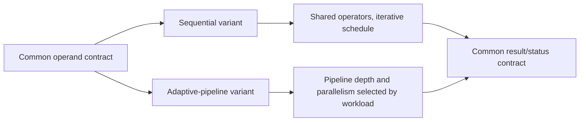

# Implementation variants

The sequential design is expected to investigate lower operator replication
and higher per-operation latency. The adaptive design is expected to
investigate throughput, buffering, and timing closure. Neither outcome is
assumed. Actual sharing must be established from HLS/synthesis reports, not
source directives alone.

Both variants remain future implementations. Stage 9 freezes only their
equivalent external semantics and measurement plan.
