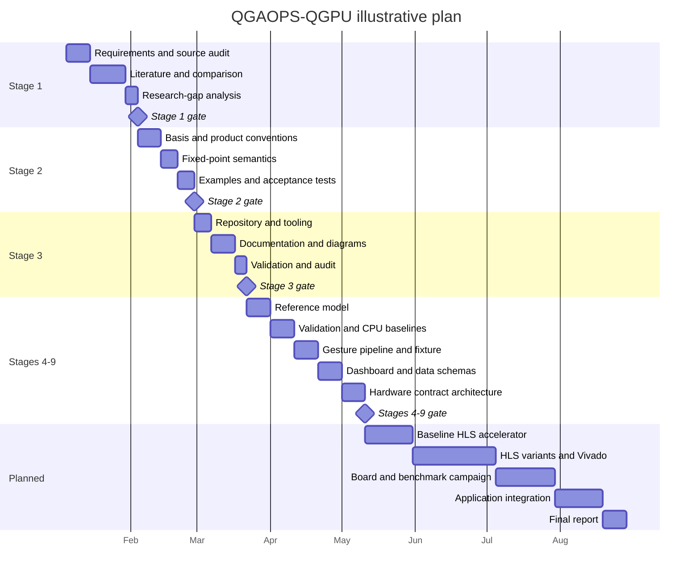

# Project timeline

Dates are illustrative planning dates, not claims of completed work. The
critical path is the mathematical contract -> reference -> HLS -> board
validation sequence; failures return to the preceding gate.
